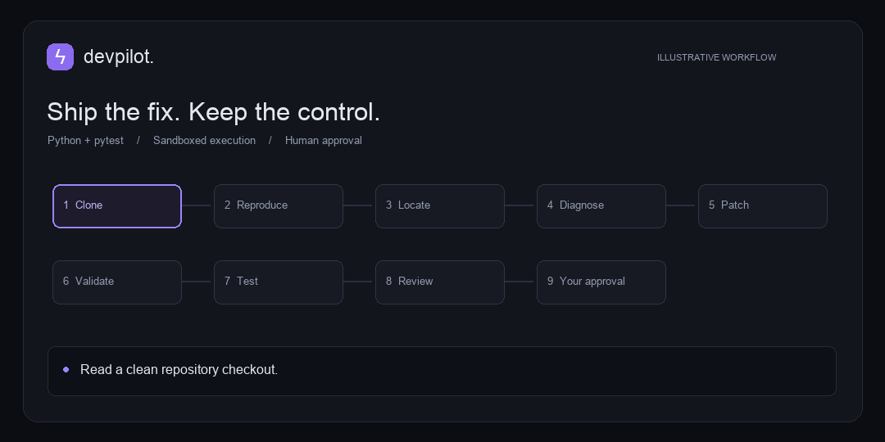
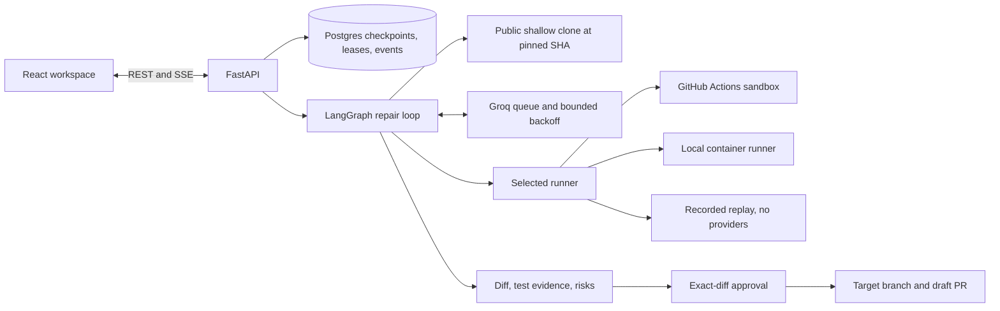

# DevPilot

An agent for small, reproducible Python/pytest bugs. It investigates a public GitHub repository, proposes a bounded patch, runs tests through the selected sandbox, and pauses for human review. Only approval of the exact tested diff can create a target branch and draft PR. There is no merge operation.

**Never publish or host DevPilot on ChatGPT Sites or another ChatGPT/OpenAI hosting service.** The owner authorized deployment to Cloudflare Pages, Render and Neon. See [deployment status](docs/DEPLOYMENT.md) for verified progress; configuration alone is not a completed deployment.

## Honest status

The website, API and CLI now select the same runner. Checkpoints, expiring database leases, remote job reattachment, public-repository policy, cold-start recovery, review tools and recorded replay storage are implemented. The UI is organized around starting a run, following the investigation and reviewing the patch.

**A complete real GitHub/Groq repair is still unverified.** The owner confirmed Groq key rotation, but the local sandbox repository, sandbox token, target token and allowlist are not configured. The [real-service verification table](docs/VERIFICATION.md) explicitly lists every live scenario as not run. There are **zero real recordings and zero executed real evaluation cases**. Scripted examples and mocked controller tests never count as autonomous repair successes.

Local evidence is in [the quality report](docs/quality/REPORT.md). Phase reports [1](docs/PHASE-1.md), [2](docs/PHASE-2.md), [3](docs/PHASE-3.md), [4](docs/PHASE-4.md), [5](docs/PHASE-5.md), [6](docs/PHASE-6.md), [7](docs/PHASE-7.md), [8](docs/PHASE-8.md) and [9](docs/PHASE-9.md) distinguish implementation, local tests and unmet live criteria.



## Run the website locally

Use Python 3.11, Git, Node 22.14+ and npm. Install [uv](https://docs.astral.sh/uv/) or use an equivalent Python virtual environment.

```sh
uv sync --locked --extra dev
npm ci --prefix frontend
npm run dev --prefix frontend
```

Open `http://127.0.0.1:5173/`. **Try an example** runs an explicitly labelled illustrative walkthrough without a backend, credentials or provider calls. Live runs and real recordings require the API. Browser examples are local to that browser and are not shareable server records.

For a local read-only replay API, no provider calls are needed. Replace the worker-token placeholder with a strong random value:

```sh
mkdir -p .devpilot
RUNNER_MODE=replay DATABASE_URL=sqlite:///.devpilot/local.sqlite \
  DATABASE_AUTO_CREATE=true API_ACCESS_TOKEN=YOUR_LOCAL_WORKER_TOKEN \
  uv run uvicorn app.main:app --host 127.0.0.1 --port 8000 --workers 1
```

SQLite is a development fallback. Production uses PostgreSQL and Alembic migrations. Replay mode refuses live execution. Real recordings appear only after an observed successful Actions-backed investigation; none are bundled as real evidence.

## Configure live runs

Copy `.env.example` to ignored `.env`, then set:

| Variable | Purpose |
| --- | --- |
| `RUNNER_MODE=github_actions` | Production runner; Docker is refused unless `APP_ENV=local` |
| `SANDBOX_REPO` | Separate public `owner/devpilot-sandbox` repository |
| `SANDBOX_GITHUB_TOKEN` | Fine-grained PAT for that sandbox only: Actions write, Contents write |
| `TARGET_GITHUB_TOKEN` | Different PAT for target repos only: Contents write, Pull requests write |
| `ALLOWED_TARGET_REPOS` / `ALLOWED_TARGET_OWNER` | Explicit public target policy; mirror these in sandbox Actions variables |
| `GROQ_API_KEY`, `GROQ_MODEL` | Backend-only key and model ID, checked against the provider's models API |
| `API_ACCESS_TOKEN` | Strong worker credential for protected API endpoints |
| `DATABASE_URL` | Pooled PostgreSQL URL, including provider SSL settings |
| `CORS_ORIGINS` | Exact frontend origins; `ALLOWED_ORIGINS` is an alias |
| `MAX_CONCURRENT_RUNS`, `MAX_QUEUED_RUNS` | Bounded execution and visible queue; defaults 1 and 20 |

`GITHUB_TOKEN` is deprecated and is not used for sandbox dispatch or target publication. Neither PAT nor the Groq key belongs in the browser, repository, workflow or container. `.env` is ignored. The [credential inventory](docs/security/PHASE-0.md) records the original audit and later phase changes.

Follow [sandbox provisioning and live verification](docs/VERIFICATION.md): copy the supplied workflow to the public sandbox's default branch, enable Actions, configure its allowlist variables, and publish the three small known-bug example repos under your account. No working remote example URL is invented.

For local Postgres:

```sh
docker compose up -d db
uv run alembic upgrade head
uv run uvicorn app.main:app --host 127.0.0.1 --port 8000 --workers 1
```

The database can instead be a pooled Neon/Supabase connection. The production API does **not** need a Docker daemon for the Actions runner. In the website's **Connect worker** dialog, use the API URL (blank for Vite's local proxy) and only `API_ACCESS_TOKEN`.

```sh
uv run devpilot doctor
uv run devpilot run https://github.com/YOUR_ACCOUNT/YOUR_PUBLIC_REPO \
  --issue 'Describe the reproducible bug' \
  --expected-failure 'tests/test_example.py::test_regression' --json-events
```

The CLI exports a review report and never publishes a target PR. The website owns the approval gate. Starting an Actions-backed test necessarily uploads its diff to a disposable **public sandbox branch**; target publication still requires approval.

## Behavior and boundaries



- Baseline runs twice. Flakiness, infrastructure errors, unrelated specified failures or an already-green suite stop with a reason.
- Every attempt starts from the pinned baseline. The validator rejects tests, protected paths, whole-file replacement, oversized patches and secret-like content. Limit: 3 attempts, 5 source files, 200 changed lines.
- Repeated errors and run/test timeouts stop retries. Passing results must preserve the baseline test inventory.
- Completed nodes and remote Actions IDs are persisted. Restart re-clones the pinned SHA and re-applies the patch; polling reattaches to a stored remote ID. Ambiguous dispatches are reconciled by stable job names, never blindly repeated. Approval waits remain reviewable.
- A 45-second database lease with 10-second heartbeats prevents duplicate ownership. Postgres behavior and process-kill recovery still require real-service evidence; local simulations pass.
- Cancellation requests remote cancellation and patch-branch cleanup. Terminal runs remain terminal. Retention cleans recorded old sandbox branches and expired temporary checkouts.
- The worker exposes observed provider budgets and queue state; unknown budgets remain unknown. Public policy metadata reads are anonymous and have a lower GitHub quota, so evaluation may need small batches.

**Network limitation:** Actions prepares dependencies inside a restricted, secret-free container with public network access. Before pytest imports or test hooks, the host disconnects networking, checks that no network remains, and acknowledges test execution. Tests have a 120-second deadline. **Installation is not offline.** Strict network denial for all repository code requires the explicit local runner with a prebuilt offline wheelhouse/image, or further Actions preparation work. This boundary has not yet been exercised on a real hosted Actions runner.

The local runner uses non-root execution, no networking, a read-only root, tmpfs, no host mounts/secrets, CPU/memory/process limits and offline dependencies. Set `APP_ENV=local RUNNER_MODE=docker`, prepare `sandbox-image/wheels/`, and build `devpilot-sandbox:py311`. Missing dependencies fail clearly; there is no host-execution fallback.

Containers share a host kernel. Test code can interfere with its own process/report. Passing tests, policy checks and AI review are evidence, not proof of correctness. Redaction covers configured secrets and common formats, not every possible secret.

## Evaluation and checks

The 25 injected-bug definitions are stored in `backend/app/evaluation_cases.json` and seeded into `eval_cases`. Prepare local Git fixtures without executing them:

```sh
uv run python scripts/prepare_evaluation.py --output .devpilot/evaluation-repos
```

Publish those fixtures to your own public allowlisted repos and fill the generated manifest with real URLs and pinned SHAs. Then run through the **same API pipeline**:

```sh
GROQ_KEY_ROTATION_CONFIRMED=1 uv run python scripts/evaluate.py \
  --manifest .devpilot/evaluation-repos/manifest.json --case case-01
```

No approval or PR is issued by evaluation. The driver records passing/failed results, attempts, duration, model, commit, stop reason and remote evidence. Commit mismatches fail the case. Old result rows without provenance do not become measured repairs. **Repair success** appears only after real API evaluation records exist. Human approval is recorded separately and does not count as measured repair success.

```sh
uv run pytest -q                    # excludes @pytest.mark.live
uv run ruff check backend scripts sandbox-image
uv run mypy backend/app
npm test --prefix frontend
npm run build --prefix frontend
npm run check:typography --prefix frontend
npm run test:e2e --prefix frontend
```

Playwright smoke tests use mocked API data, run on desktop/mobile, and exercise replay, diff inspection and explicit approval. They are not real-service repair tests. Optional Docker checks require `DEVPILOT_DOCKER_TESTS=1`; opt-in live tests/checklists are described in [VERIFICATION.md](docs/VERIFICATION.md). Local Lighthouse scores, version, scope and raw reports are in [quality evidence](docs/quality/REPORT.md).

The new landing page is at `/`, with the focused run form at `/workspace`. See the [landing redesign and measured checks](docs/LANDING-REDESIGN.md); earlier connection fixes are in the [UI polish report](docs/UI-POLISH.md).

## API and hosting

Protected API: runs/list/detail/events, approve/reject/cancel, JSON report, limits, evaluation and repository readiness/issue reads. Public read-only routes: health and recordings. SSE has 15-second heartbeats, Last-Event-ID reconnect and client polling fallback. `/api/health?lightweight=true` supports bounded cold-start probing. Run creation accepts a stable `Idempotency-Key` so a lost response does not create another job.

Deployment to Cloudflare Pages, Render and Neon is authorized and being prepared. Check [deployment status](docs/DEPLOYMENT.md) for actual URLs and verification before assuming services are online. [Render's free services](https://render.com/docs/free) can sleep after idle periods and restart; the client shows a bounded waking state rather than an immediate 8-second failure. Free quotas and public runner availability vary. No paid fallback or guaranteed uptime is claimed.
